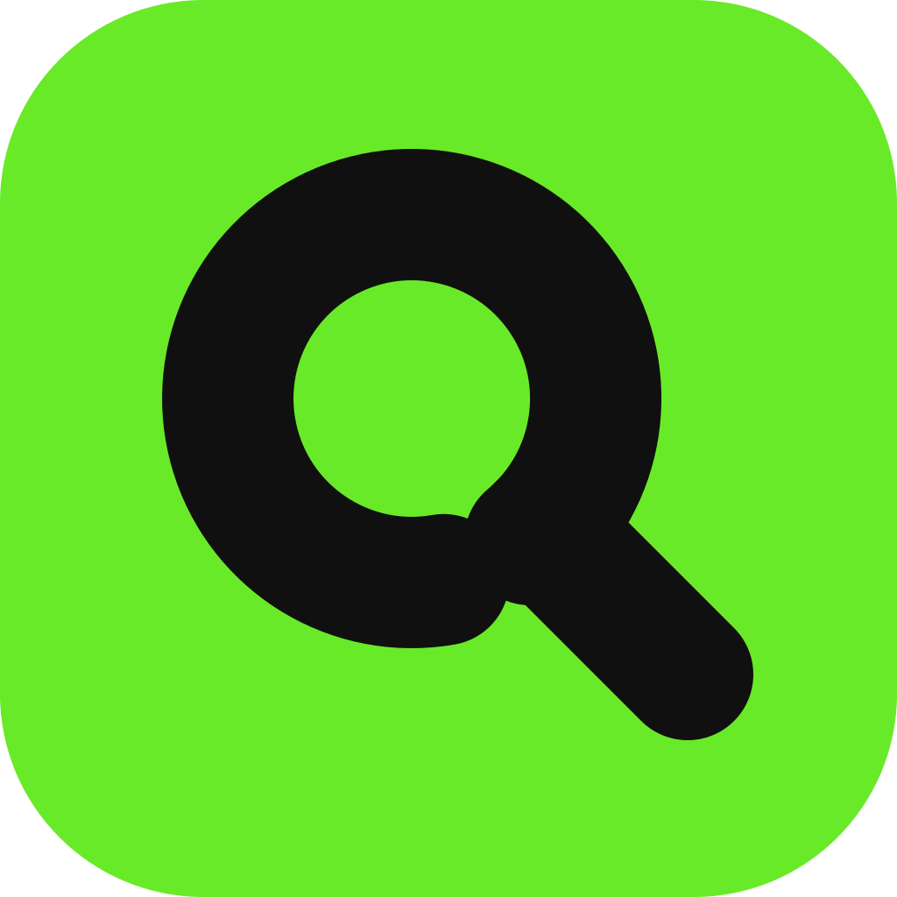
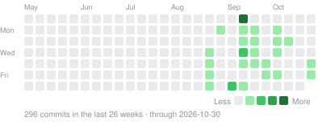
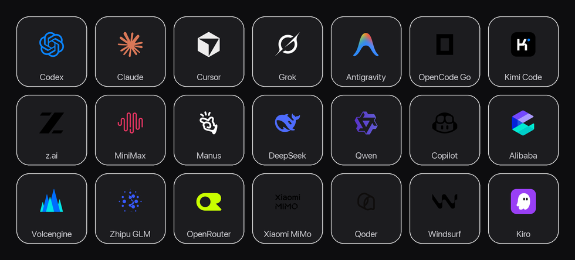

<div align="center">



# QuotaBar

**Every AI coding limit, at a glance — in the menu bar, the notch, at the screen's edge or on the desktop.**

[](https://github.com/QuotaBar/QuotaBar/releases/latest)
[](https://quota.bar/)
[](https://github.com/QuotaBar/QuotaBar/stargazers)
[](https://github.com/QuotaBar/QuotaBar/commits/main)
[](https://github.com/QuotaBar/QuotaBar/graphs/commit-activity)
[](https://github.com/QuotaBar/QuotaBar/actions/workflows/ci.yml)
[](https://github.com/QuotaBar/QuotaBar/releases/latest)
[](LICENSE)

QuotaBar is a macOS menu-bar app that shows how much of each AI coding service's quota
you have used, when each window resets, and roughly what it has cost — for twenty-one
providers, read and worked out on your own Mac. No account, no telemetry.

[Download](https://github.com/QuotaBar/QuotaBar/releases/latest) ·
[Website](https://quota.bar) ·
[Changelog](CHANGELOG.en.md) ·
[Architecture](ARCHITECTURE.md)

**English** · [简体中文](README.zh-CN.md)

</div>

---

## Install

```bash
brew tap gentpan/tap
brew trust gentpan/tap      # Homebrew 6 gates third-party taps
brew install --cask quotabar
```

Or download the `.dmg` from [Releases](https://github.com/QuotaBar/QuotaBar/releases/latest)
and drag `QuotaBar.app` into `/Applications`. Builds are signed with a Developer ID
certificate and notarized by Apple, so Gatekeeper opens them without a detour.

Requires macOS 14 (Sonoma) or later. Apple Silicon and Intel. The interface is in
English and Simplified Chinese and follows the system language unless you pick one.

## Recent updates

<!-- changelog:start -->
<!-- Generated from CHANGELOG.en.md by Scripts/sync_changelog.py. Do not edit by hand. -->

Latest release **0.6.0** (2026-10-30) · [full changelog](CHANGELOG.en.md)

<details open>
<summary><b>2026-10-30</b> · 0.6.0 · 4 added · 1 fixed</summary>

**Added**

- z.ai is read automatically when ZCode is signed in on this Mac, with no API key to paste and no need to open ZCode. The card shows the plan, such as Lite, and usage to a fraction of a percent from the actual counts.
- MiniMax is read automatically when MiniMax Code is signed in, Global or China edition, with the plan's name, such as Go, and the account — its name, for an account without an address. Its sign-in lasts an hour; while QuotaBar runs it renews and saves the sign-in the way MiniMax Code does, so readings stay current with MiniMax Code closed.
- Antigravity is read with the app closed, for as long as its sign-in lasts: once the token it saved runs out after an hour, QuotaBar renews one of its own from the saved refresh token and keeps it in memory only, leaving Antigravity's sign-in untouched and signed in. The card still names the account signed in.
- Qoder's plan and credits are read automatically when the Qoder app is signed in, with no Cookie to paste and no need to open Qoder. Its sign-in is encrypted with a key in the keychain, so macOS asks once on the first read — press “Allow keychain access” in Settings or on the card and choose Always Allow. A qoder.com Cookie can still be pasted in Settings for an account without the app.

**Fixed**

- A pasted MiniMax API key read no quota at all: the reply is now read by the fields MiniMax actually sends, and calls left are no longer shown as calls used.

</details>

<details>
<summary><b>2026-10-29</b> · 0.6.0 · 2 fixed</summary>

**Fixed**

- With Antigravity closed, the card no longer lists a dozen internal models and repeated model names. It shows the app's own two groups, Gemini and Claude and GPT, each with its 5-hour and weekly limit, Gemini first, and the menu bar no longer leads with Claude.
- With Antigravity closed, weekly limits are read too, so a half-spent Gemini week no longer shows as 0%. The plan chip shows the subscription, such as Google AI Pro, instead of ANTIGRAVITY.

</details>

<details>
<summary><b>2026-10-13</b> · 0.5.31 · 2 added · 1 changed · 2 fixed</summary>

**Added**

- Mac, iOS and widgets support migrated X Subscription accounts, grouping Cursor and Grok only for the same verified workspace and seat and showing shared weekly usage and prepaid balance once. Existing plans keep their original presentation.
- iOS DeepSeek uses a balance-only card: one large amount for a single currency, side-by-side CNY and USD balances, and no balance progress bars or repeated quota rows. Details and sharing use the same layout.

**Changed**

- Codex uses one flat OpenAI mark in the existing island blue across Mac, iOS and widgets, replacing the old gradient icon.

**Fixed**

- Migrated plans no longer reuse stale Cursor monthly quotas or duplicate Grok Bot allowances. Unknown usage remains a dash; reported zero usage and zero balances remain valid.
- Existing Cursor selections, widgets and links resolve to the shared card. Sync, cache restoration and multi-Mac merges preserve shared subscription identity.

</details>

<!-- changelog:end -->

## Activity

<p align="center">
  
</p>

<p align="center">
  <a href="https://star-history.com/#QuotaBar/QuotaBar&Date">
    <picture>
      <source media="(prefers-color-scheme: dark)" srcset="https://api.star-history.com/svg?repos=QuotaBar/QuotaBar&type=Date&theme=dark">
      
    </picture>
  </a>
</p>

## Supported services

<p align="center">
  
</p>

QuotaBar reads each service from a sign-in you already have and shows what matters: the plan, how much of each window is used, when it resets, and the estimated spend — all read and worked out on your Mac.

- **Signed-in CLIs and apps are read on their own**, with nothing to paste: Codex, Claude, Cursor, Grok, Antigravity, OpenCode Go, Kimi Code, z.ai (via ZCode), MiniMax (via MiniMax Code), Qoder, GitHub Copilot, Windsurf and Kiro. A few sign-ins — Qoder's and Grok Bot's — are encrypted with a key macOS asks about once; press **Allow keychain access** and choose Always Allow.
- **Paste a key or cookie** for a service with no local sign-in: DeepSeek, OpenRouter, Manus, Qwen, Alibaba, Volcengine, Zhipu GLM and Xiaomi MiMo.

Services marked *experimental* are built from the providers' own consoles and CLIs and not yet checked against a live account; Settings labels them.

## Where the numbers show

**Menu bar and panel**
- Eleven glyph styles, four of them *stepped* so the reading can be counted rather than
  estimated; or a text reading, the logo alone, or nothing.
- The glyph splits a **short** horizon (5-hour, rolling) from a **long** one (weekly,
  billing cycles), because collapsing them hides which limit is actually near.
- Click it for the panel: a spend card on top — spend, tokens or cost per million
  tokens, for today, yesterday or 30 days, split by CLI — then one card per provider
  with its two most important windows; the rest, the trend, 30-day spend and the status
  page fold out beneath.
- Click any percentage to flip between used and left, any reset time between a countdown
  and the clock. Right-click a card to copy it as an image.
- `Esc` closes, `⌘R` refreshes everything, `⌘,` opens Settings. A global hotkey can open
  it from anywhere.

**Notch island** — on notched Macs the figures sit either side of the notch. Hover to open
three pages (limits, usage, overview) with five chart styles. A soft glow turns amber and
red as a limit nears, and the island peeks out on its own the first time one crosses the
warning line. A low-power mode glows only when something happens.

**Edge dock** — hides until the pointer reaches the screen edge. Double-click a window
(5-hour, weekly, a model's own) to choose what its ring shows.

**Desktop cards** — as many as you like, sitting on the desktop below your windows or
kept above them: big figure, gauge, spend trend, day by day, provider grid, closest to the
limit, and the classic list, each in small, medium or large. Drag to move, double-click
for the panel, right-click to change style, size or provider.

With two screens, choose which one the island, dock and cards appear on.

## Pace, alerts and spend

- **Pace.** A thin tick on every bar marks where even use would be by now. A window on
  course to finish tight says so; one on course to run out shows a flame and when.
- **Alerts.** Warning and critical thresholds, plus *almost out*, *cutting it close* and
  *will run out* — each fires once per crossing and once per reset period.
- **Resets.** QuotaBar reads a provider again the moment a window resets, and marks it
  in that provider's colour: the dock slides out and sweeps the ring full with a card
  beside it, the island opens a "limit reset" banner, the menu-bar glyph refills with a
  sheen, and the row says it just reset; a notification follows if the window had been
  used past 90%.
- **Spend.** Estimated locally from Claude Code, Codex CLI and OpenCode session logs, in
  dollars or one of ten other currencies at daily reference rates, counting all tokens or
  input and output only. QuotaBar keeps its own day-by-model archive, so the figures do
  not shrink when a CLI prunes old logs.
- **Usage page.** A year heatmap and volume chart in Settings.
- **Share card.** Your last 7 days, 30 days, 3 months, year or all time, by API value or
  tokens; the card turns black past $1,000 and blue past $10,000. 4:5, 1:1 or 9:16, saved
  as a 1080-pixel PNG or copied.
- **Service status.** The providers' own status pages, judged by the coding components —
  Claude Code, the Codex CLI — with 30 days of history in Settings.

## Your data

Automatic providers reuse the session your CLI already created — the app never asks for a
password. Manually entered tokens go to the **macOS login keychain**, never to a file.
Preferences live in `~/.config/quotabar/config.json` (mode `0600`) and contain no
secrets. There is no analytics and no telemetry.

QuotaBar connects only to:

- the usage endpoints of the providers you turn on, with your own session or key;
- their public status pages, such as `status.claude.com`;
- `open.er-api.com`, once a day, for exchange rates;
- `quota.bar`, to check for and download updates, and when you send feedback. A check carries the app version and, like any web request, your IP address; quota.bar keeps only a salted hash of it to count active installs and deletes the raw logs after seven days. No usage data is sent;
- GitHub, for updates when quota.bar cannot be reached, and to fetch model prices (LiteLLM's catalog).

With a proxy set (HTTP, HTTPS or SOCKS5), all of it goes through the proxy. Your usage is
never sent to a server of ours. While a screen share or recording is on, QuotaBar can
hide the figures and leave only its mark in the menu bar.

## For other tools

Turn on **Local API** in Settings → General and QuotaBar serves JSON on this Mac only:

```bash
curl http://127.0.0.1:6736/v1/limits   # every window, percent and reset
curl http://127.0.0.1:6736/v1/spend    # dollars and tokens: today, yesterday, 30 days
```

No credentials, no account names. From a terminal, the same limits without the app open:

```bash
/Applications/QuotaBar.app/Contents/MacOS/QuotaBar --json          # cached up to five minutes
/Applications/QuotaBar.app/Contents/MacOS/QuotaBar --json --force  # ask every provider now
```

## First run

1. On a fresh install QuotaBar turns on only the providers whose tools it finds signed in
   on this Mac, and a welcome card in the panel says how many.
2. Automatic providers need the matching CLI signed in (`codex`, `claude`, `grok`,
   `gh`) or the app installed (Antigravity, Cursor, Windsurf).
3. Manual providers: open Settings → **Providers**, paste the token described under the
   row, then **Test connection** — it bypasses every cache and asks the source directly.

The panel refreshes every 5, 15 or 30 minutes, on wake, and when the network comes back;
the footer's button refreshes everything at once. Upgrading from a build that stored
credentials in `config.json`? They are moved into the keychain on first launch and erased
from the file.

## Build & run

Requires macOS 14+ and a **full Xcode toolchain** — CommandLineTools alone lacks the
SwiftUI macro plugin, so the build fails on `@State`.

```bash
export DEVELOPER_DIR=/Applications/Xcode-beta.app/Contents/Developer
swift build && swift test
UNIVERSAL=0 ./Scripts/package_app.sh   # QuotaBar.app in place; drop UNIVERSAL=0 for Intel too
open QuotaBar.app
```

The app is a menu-bar agent, so there is little to screenshot. Render the surfaces
off-screen instead — CI runs the first two as smoke tests. Add `--lang en` or `--lang zh`
to render one language:

```bash
.build/debug/QuotaBar --snapshot ./snapshots             # panel, dock, notch strip
.build/debug/QuotaBar --settings-preview ./settings      # every settings section, both languages
.build/debug/QuotaBar --icon-preview ./icons             # all eleven menu-bar styles
.build/debug/QuotaBar --island-preview ./island          # island pages and chart styles
.build/debug/QuotaBar --widget-concepts ./cards          # every desktop card, every size
```

Glass, vibrancy and springs only exist on screen — `ImageRenderer` draws none of them.
For those, open the real thing:

```bash
.build/debug/QuotaBar --settings-window about
.build/debug/QuotaBar --panel-window
QUOTABAR_DOCK_TRACE=1 QUOTABAR_DOCK_SLIDE=2 ./QuotaBar.app/Contents/MacOS/QuotaBar
```

For a single provider: `QuotaBar --provider claude`; for the status pages:
`QuotaBar --status`.

## Distribution

Developer ID only, not the App Store — the sandbox forbids reading `~/.codex`,
`~/.claude` and another app's keychain item, which is the entire feature set.

`package_app.sh` picks its signing tier automatically:

| What you have | What others get |
|---|---|
| Nothing | Ad-hoc signature — runs on your Mac only. Others see *"QuotaBar is damaged"*. |
| Developer ID certificate | Hardened runtime. Others see *"Apple cannot check it for malicious software"*. |
| Certificate + notarization | Gatekeeper accepts it — the normal *"downloaded from the internet"* prompt. |

Store a notarization credential once (needs an
[app-specific password](https://appleid.apple.com)):

```bash
xcrun notarytool store-credentials QuotaBar \
  --apple-id you@example.com --team-id <YOUR_TEAM_ID>
```

### Cutting a release

```bash
./Scripts/release.sh
```

Notarizes, staples, zips with `ditto` (which preserves the ticket), builds a signed and
notarized `.dmg`, computes both SHA-256s, and writes a ready-to-commit Homebrew cask to
`dist/quotabar.rb`. It **refuses to produce a release if Gatekeeper still rejects the
bundle**, so a half-signed build cannot reach users by accident. The app updates itself
only from a download signed by this app's developer and notarized by Apple.

## Spend estimates

Computed locally from `~/.claude/projects/**/*.jsonl`,
`~/.codex/sessions/**/rollout-*.jsonl` and OpenCode's own database, priced from a live
catalog that matches exact model ids. They are an estimate for orientation, **not a
bill** — they cannot see plan-included usage, discounts, or anything that happened
outside these CLIs.

Two things are easy to get wrong here and are pinned by tests: Claude Code writes the
same assistant turn into every session file that replays it (deduplicated on
`message.id` + `requestId`), and Codex reports `input_tokens` inclusive of
`cached_input_tokens` (not double-charged).

## Architecture

- `Sources/QuotaCore` — provider protocol, HTTP helpers, config and keychain store,
  credential readers, cost estimator and usage archive, pricing catalog, status pages,
  updater, one file per provider group.
- `Sources/QuotaBar` — the app: an AppKit status item and panels hosting SwiftUI — usage
  store, menu-bar glyph, panel, settings, notch island, edge dock, desktop cards, share
  card, local API.
- `Tests/QuotaCoreTests` — parser fixtures, cost regressions, config migration, updater
  verification. Everything testable lives in QuotaCore.
- The website and the Quota Run service live in separate repositories.

Adding a provider, and every design decision worth knowing before changing one:
[ARCHITECTURE.md](ARCHITECTURE.md). Every change to the app is logged, dated, in
[CHANGELOG.en.md](CHANGELOG.en.md) (English) and [CHANGELOG.md](CHANGELOG.md) (Chinese).

## Acknowledgements

QuotaBar builds on these open-source projects and this typeface. Thank you.

| Project | Author | License | What QuotaBar took |
|---|---|---|---|
| [codex-island](https://github.com/ericjypark/codex-island) | Eric Park | MIT | The notch island's look and motion |
| [OpenUsage](https://github.com/robinebers/openusage) | Robin Ebers | MIT | The menu panel, pace hints and the share card |
| [CodexBar](https://github.com/steipete/CodexBar) | Peter Steinberger | MIT | How providers report their usage; QuotaBar is a clean-room Swift implementation inspired by it |
| [theSVG](https://github.com/GLINCKER/thesvg) | thesvg.org | MIT | The vector masters of the provider logos, kept in `Assets/logos-src-*.svg` |
| [Instrument Sans](https://github.com/Instrument/instrument-sans) | The Instrument Sans Project Authors | SIL OFL 1.1 | The typeface of the QuotaBar wordmark and the website |

QuotaBar is an independent third-party app. It is not affiliated with, endorsed by, or
sponsored by Anthropic, OpenAI, Cursor, Google, xAI, GitHub, X or any other company it
mentions. Their names and logos belong to their respective owners.

## License

MIT — see [LICENSE](LICENSE).
